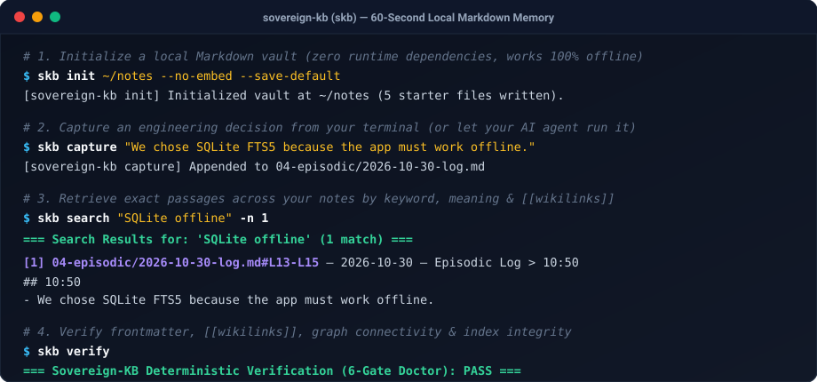
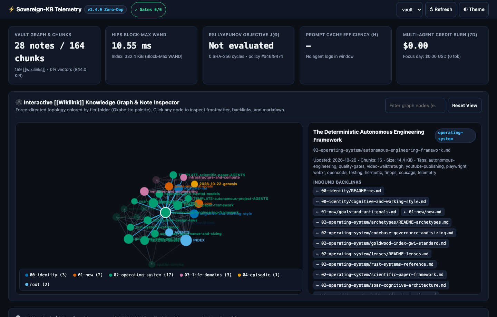

# Sovereign-KB (`skb`)

**AI coding agents forget every decision the moment a chat ends, and your own notes end up scattered across tools. `skb` gives you both a searchable memory built from plain Markdown files you own.**

[](LICENSE)
[](pyproject.toml)
[-success.svg)](pyproject.toml)

## Quick start

```bash
uv tool install git+https://github.com/iliachry/sovereign-kb.git
skb init ~/notes --no-embed --save-default
skb capture "We chose SQLite FTS5 because the app must work offline."
skb search "SQLite offline"   # prints the matching passage with its file path and line numbers
```

## What it does

- **Captures decisions where you work**: `skb capture "..."` appends a timestamped entry to `04-episodic/`, from your terminal or your agent.
- **Finds them again in one command**: keyword (BM25) + `[[wikilink]]` graph + optional local embeddings, returning the exact file and line numbers.
- **Built for AI coding agents**: `--json` output and a three-line `AGENTS.md` snippet for Claude Code, Cursor, OpenCode and Codex.
- **Works on notes you already have**: point `--vault` at an Obsidian vault or a `docs/` folder; nothing is rewritten.
- **Zero dependencies, fully offline**: Python 3.10+ standard library + SQLite FTS5. Delete `.kb/` and your Markdown stays untouched.
- **Optional extras**: a repository quality gate (`gwi`) and signed `.evr` artifact capsules, part of the [Sovereign Organon](#sovereign-organon).



---

## 💡 Why `skb`?

| Capability | `ripgrep` (`rg`) | GUI Note Apps (Obsidian) | Cloud / Docker RAG | **`sovereign-kb` (`skb`)** |
| :--- | :---: | :---: | :---: | :---: |
| Plain `.md` files you own | ✅ | ✅ | ❌ | ✅ |
| Zero runtime dependencies | ✅ | ❌ | ❌ | ✅ |
| BM25 ranking + `[[wikilink]]` graph boost | ❌ | ❌ | ❌ | ✅ |
| Built for terminal & AI coding agents (`--json`) | ⚠️ *(line grep)* | ❌ | ⚠️ | ✅ |
| Optional local vectors (Ollama) & Rust WAND (`hips`) | ❌ | Plugins | Heavy | ✅ |

---

## ⚡ Step-by-Step Walkthrough (Works 100% Offline)

### 1. Install via `uv` (or `pipx`)

```bash
uv tool install git+https://github.com/iliachry/sovereign-kb.git
```

Installing from a local checkout instead? `uv tool install ~/path/to/sovereign-kb` installs a *copy*, which keeps running the old code after you commit to the checkout. `skb` notices: once the checkout has commits the copy lacks, every `skb`, `gwi`, `organon` and `evr` run prints one stderr line, and `skb verify` fails Gate 0 until you run `uv tool upgrade sovereign-kb --reinstall`. `skb --version` says which state you are in. `uv tool install --editable ~/path/to/sovereign-kb` runs the checkout itself and cannot fall behind.

### 2. Initialize, Capture & Search

```bash
# Create a clean 5-file Markdown vault at ~/notes (no model server required) and save as default
# (Pass --full if you also want the 28-file starter library with architecture & paper templates)
skb init ~/notes --no-embed --save-default

# Capture an engineering decision from your terminal
skb capture "We chose SQLite FTS5 because the app must work offline."

# Search across your notes — auto-indexes and returns the exact passage and line numbers
skb search "SQLite offline" -n 1
```

Output:
```text
=== Search Results for: 'SQLite offline' (1 match) ===

[1] 04-episodic/2026-10-30-log.md#L13-L15 — 2026-10-30 — Episodic Log > 10:50
    ## 10:50
    - We chose SQLite FTS5 because the app must work offline.
```

---

## 📂 Use It on Notes You Already Have

Already have an Obsidian vault, a `docs/` directory, or a research notebook? Point `skb` directly at that folder:

```bash
# Index an existing folder of Markdown files
skb --vault ~/my-existing-notes sync --no-embed

# Search immediately
skb --vault ~/my-existing-notes search "deployment checklist"

# Check vault health (YAML frontmatter, broken [[wikilinks]], orphan notes)
skb --vault ~/my-existing-notes verify

# Optional: auto-generate missing YAML frontmatter and link orphan notes into INDEX.md
skb --vault ~/my-existing-notes verify --heal
```

---

## 🤖 Use With Your AI Coding Agent (`Claude Code`, `Cursor`, `OpenCode`, `Codex`)

Add three lines to your project's `AGENTS.md` or `CLAUDE.md` so your coding agent remembers context across sessions:

```markdown
## Persistent Project Memory (`skb`)
- Read foundational context at session start: `skb me`
- Before proposing architectural changes, search past decisions: `skb search "<topic>" --json`
- After completing a non-trivial fix or decision, record it: `skb capture "<what changed and why>"`
```

If you run a local OpenAI-compatible LLM or [Ollama](https://ollama.com/), you can also ask synthesized questions with inline file citations:

```bash
skb ask "What are the 6 pillars of deterministic autonomous engineering?"
```

---

## 📊 Interactive Knowledge Graph & Observability Dashboard (`skb dashboard`)

Launch a zero-dependency local web UI (or export a single self-contained HTML file) to explore your `[[Wikilink]]` Knowledge Graph, test hybrid search queries, and inspect agent token usage:

```bash
# Start live local dashboard server at http://127.0.0.1:8765
skb dashboard

# Or export a self-contained static HTML file
skb dashboard --export
```



---

## 🧭 Everyday CLI Commands

| What you want to do | Command |
| :--- | :--- |
| Initialize a new vault (5-file default, or `--full` for 28-file starter library) | `skb init ~/notes --save-default` |
| Capture a timestamped note or decision into `04-episodic/` | `skb capture "Resolved CORS issue on /api/v1"` |
| Search across notes (human output, `--json` for agents, `--explain` for scores, `--jepa` for 5th-channel latent fusion) | `skb search "CORS issue"` |
| Ask a synthesized question via local Ollama / OpenAI-compatible LLM | `skb ask "How do we handle CORS?"` |
| Re-index modified Markdown files | `skb sync` |
| Run the 6-Gate Vault Doctor (`--heal` to auto-fix frontmatter & orphans), after Gate 0 checks that an installed copy of `skb` matches its checkout | `skb verify` |
| Show the version and whether this installed copy matches its checkout (`editable`, `fresh`, `STALE`, `UNVERIFIED`) | `skb --version` |
| Atomically pull, sync, verify, commit, and push vault changes to Git (`skb pull`, `skb git-sync`, `skb push`) | `skb push -m "docs: update notes"` |
| Open the interactive `[[Wikilink]]` Knowledge Graph dashboard | `skb dashboard` |
| Print your Tier-0 profile (`00-identity/README-me.md` + `01-now/now.md`) | `skb me` |
| Print zero-context-tax Creative Mode Resumption Packet(s) (`all`, `math`, `compute`, `spatial`, `writing`) | `skb resume math` |
| Build polyglot AST/SCIP symbol & call graph and slice $k$-hop dependency subgraphs | `skb code-graph . -q "compute_goldwood_index"` |
| Run AST mutation kill-ratio probe, property-fuzz check (`GWI-SCI-06`) & formal proof verifier (`GWI-SCI-07`) | `skb falsify . --run-mutations` |
| Audit 3D Gaussian Splatting (`.ply`, `.splat`, `.ksplat`, `.spz`) assets for WebXR/Quest 3 budgets | `skb splat .` |
| Train and query the Unified Vault JEPA world model (`train`, `predict`, `plan`, `search`, `gaps`, `surprise`, `bench`, `hjepa`, `soar`, `heal`, `code`, `status`) | `skb jepa status` |
| Build privacy-filtered datasets, train 4 sovereign vault models & serve warm Critic/Embedder (`datasets`, `embedder`, `critic`, `nanolm`, `serve`, `audit`, `search`) | `skb train datasets --track retrieval` |
| Show vault & index status | `skb status` |
| Run Autonomous Human-Like Video Playback Audit (native `.mp4` stream to Bedrock Nova Pro + Triad keyframes) | `skb video audit artifacts/walkthrough_compressed.mp4` |
| Run pre-seal cross-lineage adversarial challenge, independence calibration (`N_eff >= 1.80`), and human adjudication (`skb elenchus` / `organon elenchus`) | `skb elenchus run .` |
| Run the Unified Sovereign Organon CLI (`organon status`, `organon showcase`, `organon task`, `organon elenchus`, `organon finish`, `organon sync-state`, `organon chain`, `organon evr`) | `organon status --all-nodes` |
| Run Pistis On-Chain Bilateral Negotiation, RFC 6962 Merkle Anchor, PhD Tokenomics & Software Aristocracy (`skb chain` / `organon chain`) | `organon chain full-suite` |
| Pack, inspect, search, query via SQL, zero-copy `mmap` tensors, Merkle-verify, and seal GWI/Paper/Vault/Show/Twin `.evr` ("Everything" v1.0) capsules (`evr`, `skb evr`, `organon evr`, `evr seal-gwi --require-elenchus`, `evr seal-paper`, `evr pack-vault`, `evr pack-show`, `evr pack-twin`, `skb gwi audit --seal --require-elenchus`) | `evr bench` |
| Generate a 0600 `.evr` signing key, register trusted signers, seal with `--key-file`, and require a registry-trusted signature (`evr keygen --name NAME [--out PATH] [--print-key]`, `evr trust add <keyfile> [--name]`, `evr trust list`, `evr trust remove <key_id>`, `evr verify --require-trusted`) | `evr keygen --name me` |

---

<a id="sovereign-organon"></a>

## 🏛️ The Sovereign Organon (`organon` — Open-Core Architecture)

**The Sovereign Organon** ($\text{Ὄργανον}$ — *Memory · Machine · Measure · Trust*) is [Goldwood Technologies'](https://goldwood.tech/organon) closed-loop autonomous engineering architecture. This repository ships the **MIT Open-Core foundation** (`skb`, `gwi`, `evr`, `organon`), while the multi-node autonomous delivery orchestrator (`swm`) operates as the proprietary Goldwood Studio Engine:

| Pillar | Classical Epithet | CLI Entrypoint | Role | Edition |
| :--- | :--- | :--- | :--- | :---: |
| **1. Memory** | *Episteme* ($\text{Ἐπιστήμη}$) | `skb` / `organon kb` | 4-Way Hybrid Markdown Memory, Soar 9.6 symbolic chunking & 4-Loop RSI | **MIT (Included)** |
| **2. Machine** | *Techne* ($\text{Τέχνη}$) | `organon swm` | 6-Stage Autonomous Software Factory, worktree builder & adversarial auditor | *Goldwood Studio* |
| **3. Measure** | *Phronesis* ($\text{Φρόνησις}$) | `gwi` / `organon audit` | Non-linear Goldwood Index (`G >= 9.0`), 8 Craft Lenses & Laws `L0`–`L9` gate | **MIT (Included)** |
| **4. Trust** | *Pistis* ($\text{Πίστις}$) + `.evr` | `organon chain` / `evr` | RFC 6962 Merkle proofs, 7-state bilateral licensing FSM & `.evr` zero-copy capsules | **MIT (Included)** |

```bash
# Inspect live 4-pillar Organon status and interactive workflow commandbook
organon status
organon showcase

# Audit any software repo, 3D simulation, LaTeX paper, or walkthrough video against G(S) >= 9.0
organon audit .
```

---

## 🔬 Deep Technical Guides & Power-User Subsystems

Beyond everyday note capture and search, `sovereign-kb` ships four advanced engineering subsystems documented in `docs/`:

1. **[Architecture: 4-Way Hybrid Retrieval & 6-Gate Vault Doctor](docs/ARCHITECTURE.md)**
   - How SQLite FTS5 BM25, optional [`hips`](https://github.com/jasonthird/high-performance-search-engine) Rust Block-Max WAND (`skb hips`), 768-d local Ollama embeddings, Reciprocal Rank Fusion (RRF), and 1-hop `[[Wikilink]]` graph propagation work together.
2. **[Unified Goldwood Index (`G >= 9.0`), 8 Craft Lenses & 10 Subtractive Design Laws (`GWI+ v1.4.0`)](docs/GWI.md)**
   - Non-linear quality gate (`skb gwi audit . --execute-gate`, `skb gwi status`, `skb gwi subprojects`, `--subprojects --incremental` / `gwi`) evaluating software apps (`app`), 3D simulations (`sim`), videos (`video`), LaTeX papers (`paper`), and Knowledge Base vaults (`kb`) across 8 Bi-Polar Specialist Craft Lenses, Laws `L0`–`L9`, run-bound behavioral gate receipts, and the persistent Sovereign Audit Provenance Registry (`~/.swm/audit_registry.json`).
   - Antifragility probes (`af.*`, [docs/GWI.md](docs/GWI.md)): fixes must leave regression tests (backfill with a `Regression-test-for: <sha>` commit trailer), rules must get retired as well as added, property/fuzz or mutation evidence must exist, and core modules must not import experimental ones (`[tool.gwi.barbell]` in `pyproject.toml`).
3. **[7-Archetype Project & Scientific Paper Factory (`skb scaffold`)](docs/SCAFFOLDING.md)**
   - One-command repository bootstrapping (`web-ts-3d-gis`, `python-uv-ai`, `rust-systems`, `spatial-xr-ble`, `paper-ieee-arxiv`, `game-sim-3d`, `metatopia-chameleon`) pre-wired with `AGENTS.md` and `./scripts/quality_gate.sh`.
4. **[Recursive Self-Improvement (`skb rsi`), Soar 9.6 Kernel (`skb soar`), Rust Certification & FinOps](docs/RSI.md)**
   - Closed-loop retrieval policy tuning (`skb evolve`), compile-time prompt/exemplar optimization (`skb rsi compile-prompts`), parametric Sleep-Wake LoRA/GRPO dataset export (`skb rsi sleep-consolidate`), Soar 9.6 symbolic chunking (`skb soar`), 20-domain `rustc` certification (`skb certify rust`), multi-agent token FinOps (`skb usage`), and live session & subagent liveness auditing (`skb sessions`).
5. **[Unified Vault JEPA (`skb jepa`)](docs/JEPA.md)**
   - Action-conditioned Joint-Embedding Predictive Architecture over `[[wikilink]]`, section, and episodic transitions (`skb jepa train`, `skb jepa predict`, `skb jepa gaps`, `skb jepa surprise`, `skb jepa bench`) with sphere-scaled VICReg anti-collapse regularization and zero-dependency stdlib + optional PyTorch backends.
6. **[Sovereign Vault Training & Distillation (`skb train`)](docs/TRAINING.md)**
   - Privacy-filtered 4-track vault training pipeline (`retrieval`, `critic` ORPO LoRA, `twin` distillation, and `nanolm` MLX) with deterministic SHA-256 splits and warm `/embed` + `/critic` serving.

Also included in every full starter vault (`src/sovereign_kb/starter_vault/02-operating-system/`):
- [The 6-Pillar Deterministic Autonomous Engineering Framework](src/sovereign_kb/starter_vault/02-operating-system/autonomous-engineering-framework.md)
- [The 10-Pillar Autonomous Scientific Paper Engineering Framework](src/sovereign_kb/starter_vault/02-operating-system/scientific-paper-framework.md)
- [The Unified Goldwood Index & GWI+ Standard](src/sovereign_kb/starter_vault/02-operating-system/goldwood-index-gwi-standard.md)
- [The Subtractive Design & Cognitive Load Laws (`L0`–`L9`)](src/sovereign_kb/starter_vault/02-operating-system/subtractive-design-laws.md)
- [Multi-Disciplinary Specialist Craft Lenses](src/sovereign_kb/starter_vault/02-operating-system/lenses/README-lenses.md)
- [Soar 9.6 Cognitive Architecture Reference](src/sovereign_kb/starter_vault/02-operating-system/soar-cognitive-architecture.md)
- [Rust Systems & Memory Safety Reference (`RUST-CERT-01..20`)](src/sovereign_kb/starter_vault/02-operating-system/rust-systems-reference.md)

---

## ⚙️ Environment Variables & Configuration

| Variable | Default | Description |
| :--- | :--- | :--- |
| `KB_VAULT_DIR` | `~/.config/sovereign-kb/config.json` or `~/sovereign-kb-vault` | Path to your Markdown vault directory |
| `KB_NO_EMBED` | `0` (or persisted via `skb init --no-embed` / `skb sync --no-embed`) | Set to `1` for offline lexical + graph indexing without calling Ollama |
| `KB_HIPS_BIN` | Auto-detected (`hips`, `~/.local/bin/hips`) | Optional path to `hips` Rust Block-Max WAND search binary |
| `KB_EMBED_MODEL` | `nomic-embed-text:latest` | Local Ollama embedding model name |
| `KB_EMBED_URL` | `http://127.0.0.1:11434/api/embeddings` | Primary Ollama embeddings HTTP endpoint |
| `KB_CHAT_URL` | `http://127.0.0.1:8000/v1/chat/completions` | Primary OpenAI-compatible chat endpoint for `skb ask` |
| `KB_OLLAMA_URL` | `http://127.0.0.1:11434/v1/chat/completions` | Fallback Ollama chat endpoint for `skb ask` |
| `SKB_EVR_SIGN_KEY` | unset → public demo key (warns; `signature_trust: public-demo-key`) | HMAC key for sealing and verifying `.evr` capsules. A capsule signed with the public demo key proves nothing about who sealed it — set your own key for real provenance; `evr verify --require-signature` exits 1 if a signed capsule cannot be checked |
| `SKB_EVR_TRUSTED_KEYS` | `~/.config/sovereign-kb/evr-trusted-keys.json` | Trusted `.evr` signer registry (`key_id` → name + key file; atomic 0600 writes). `evr verify` auto-uses a registry key matching the capsule's `signer_key_id` and reports `signature_trust: trusted-key:<name>` |
| `SWM_AUDIT_REGISTRY` | `~/.swm/audit_registry.json` | Path to the GWI audit registry (atomic writes, `flock`-guarded; a corrupt file is backed up to `*.corrupt-<ts>` and reported instead of being reset) |

---

## 🧪 Running the Deterministic Quality Gate

```bash
./scripts/quality_gate.sh
```

## 📄 License

MIT © [Ilias Chrysovergis](https://iliachry.gr) ([Goldwood Technologies](https://goldwood.tech) · [Metatopia](https://metatopia.gr))
