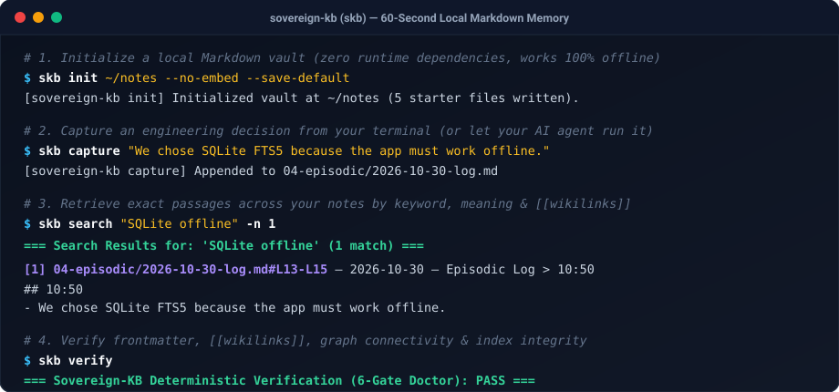
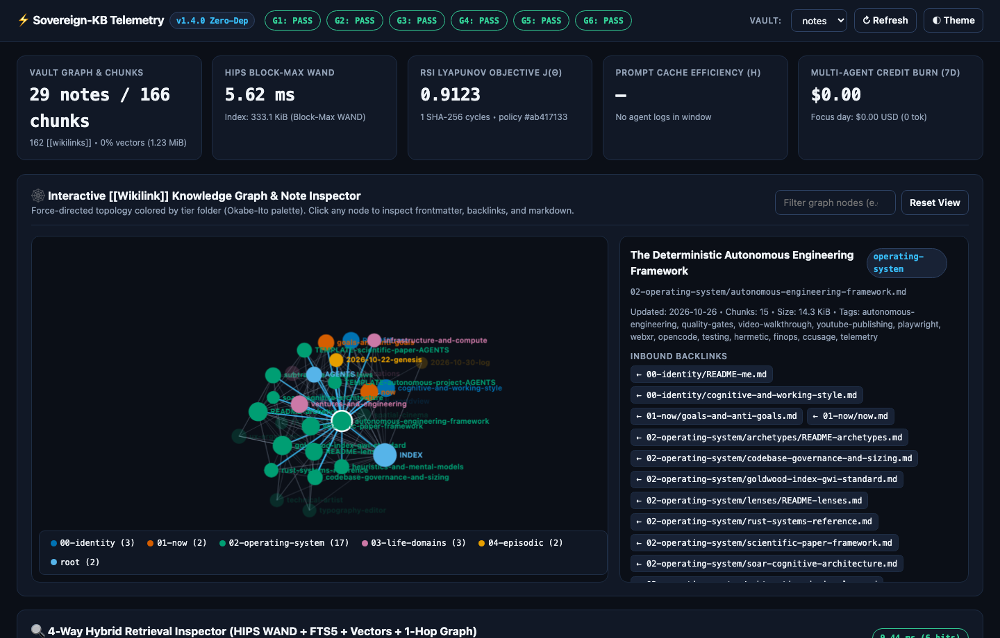

# Sovereign-KB (`skb`)

**Searchable, local-first Markdown memory for you and your AI coding agents.**

[](LICENSE)
[](pyproject.toml)
[-success.svg)](pyproject.toml)

Point `skb` at any folder of `.md` files—or initialize a fresh vault in one command. Capture architectural decisions from your terminal, search across your notes by keyword + `[[wikilinks]]` + optional local embeddings, and give your AI coding agents (`Claude Code`, `Cursor`, `OpenCode`, `Codex`) persistent project memory.

Everything runs locally on **Python 3.10+ standard library + SQLite FTS5** with **zero runtime dependencies**. Delete `.kb/` at any time and your plain Markdown files remain untouched.



---

## 💡 Why `skb`?

- **Decisions disappear into chat history**: When you or your coding agent solve a tricky bug or make an architectural trade-off, `skb capture "..."` appends a timestamped Markdown entry to `04-episodic/` (auto-indexed on your next `search`, `status`, or `verify`, or immediately with `--sync`).
- **New agent sessions start with amnesia**: Instead of re-explaining your stack and past decisions in every chat, your agent runs `skb search "<topic>" --json` (or `skb me`) and retrieves the exact passage and file path.
- **Zero-dependency, local-first durability**: No Docker containers, no cloud vector accounts, and no heavy Python dependency trees.

| Capability | `ripgrep` (`rg`) | GUI Note Apps (Obsidian) | Cloud / Docker RAG | **`sovereign-kb` (`skb`)** |
| :--- | :---: | :---: | :---: | :---: |
| Plain `.md` files you own | ✅ | ✅ | ❌ | ✅ |
| Zero runtime dependencies | ✅ | ❌ | ❌ | ✅ |
| BM25 ranking + `[[wikilink]]` graph boost | ❌ | ❌ | ❌ | ✅ |
| Built for terminal & AI coding agents (`--json`) | ⚠️ *(line grep)* | ❌ | ⚠️ | ✅ |
| Optional local vectors (Ollama) & Rust WAND (`hips`) | ❌ | Plugins | Heavy | ✅ |

---

## ⚡ Try It in 60 Seconds (Works 100% Offline)

### 1. Install via `uv` (or `pipx`)

```bash
uv tool install git+https://github.com/iliachry/sovereign-kb.git
```

### 2. Initialize, Capture & Search

```bash
# Create a clean 5-file Markdown vault at ~/notes (no model server required) and save as default
# (Pass --full if you also want the 28-file starter library with architecture & paper templates)
skb init ~/notes --no-embed --save-default

# Capture an engineering decision from your terminal
skb capture "We chose SQLite FTS5 because the app must work offline."

# Search across your notes — auto-indexes and returns the exact passage and line numbers
skb search "SQLite offline" -n 1
```

Output:
```text
=== Search Results for: 'SQLite offline' (1 match) ===

[1] 04-episodic/2026-10-30-log.md#L13-L15 — 2026-10-30 — Episodic Log > 10:50
    ## 10:50
    - We chose SQLite FTS5 because the app must work offline.
```

---

## 📂 Use It on Notes You Already Have

Already have an Obsidian vault, a `docs/` directory, or a research notebook? Point `skb` directly at that folder:

```bash
# Index an existing folder of Markdown files
skb --vault ~/my-existing-notes sync --no-embed

# Search immediately
skb --vault ~/my-existing-notes search "deployment checklist"

# Check vault health (YAML frontmatter, broken [[wikilinks]], orphan notes)
skb --vault ~/my-existing-notes verify

# Optional: auto-generate missing YAML frontmatter and link orphan notes into INDEX.md
skb --vault ~/my-existing-notes verify --heal
```

---

## 🤖 Use With Your AI Coding Agent (`Claude Code`, `Cursor`, `OpenCode`, `Codex`)

Add three lines to your project's `AGENTS.md` or `CLAUDE.md` so your coding agent remembers context across sessions:

```markdown
## Persistent Project Memory (`skb`)
- Read foundational context at session start: `skb me`
- Before proposing architectural changes, search past decisions: `skb search "<topic>" --json`
- After completing a non-trivial fix or decision, record it: `skb capture "<what changed and why>"`
```

If you run a local OpenAI-compatible LLM or [Ollama](https://ollama.com/), you can also ask synthesized questions with inline file citations:

```bash
skb ask "What are the 6 pillars of deterministic autonomous engineering?"
```

---

## 📊 Interactive Knowledge Graph & Observability Dashboard (`skb dashboard`)

Launch a zero-dependency local web UI (or export a single self-contained HTML file) to explore your `[[Wikilink]]` Knowledge Graph, test hybrid search queries, and inspect agent token usage:

```bash
# Start live local dashboard server at http://127.0.0.1:8765
skb dashboard

# Or export a self-contained static HTML file
skb dashboard --export
```



---

## 🧭 Everyday CLI Commands

| What you want to do | Command |
| :--- | :--- |
| Initialize a new vault (5-file default, or `--full` for 28-file starter library) | `skb init ~/notes --save-default` |
| Capture a timestamped note or decision into `04-episodic/` | `skb capture "Resolved CORS issue on /api/v1"` |
| Search across notes (human output, `--json` for agents, `--explain` for scores) | `skb search "CORS issue"` |
| Ask a synthesized question via local Ollama / OpenAI-compatible LLM | `skb ask "How do we handle CORS?"` |
| Re-index modified Markdown files | `skb sync` |
| Run the 6-Gate Vault Doctor (`--heal` to auto-fix frontmatter & orphans) | `skb verify` |
| Atomically pull, sync, verify, commit, and push vault changes to Git | `skb push -m "docs: update notes"` |
| Open the interactive `[[Wikilink]]` Knowledge Graph dashboard | `skb dashboard` |
| Print your Tier-0 profile (`00-identity/README-me.md` + `01-now/now.md`) | `skb me` |
| Show vault & index status | `skb status` |

---

## 🔬 Deep Technical Guides & Power-User Subsystems

Beyond everyday note capture and search, `sovereign-kb` ships four advanced engineering subsystems documented in `docs/`:

1. **[Architecture: 4-Way Hybrid Retrieval & 6-Gate Vault Doctor](docs/ARCHITECTURE.md)**
   - How SQLite FTS5 BM25, optional [`hips`](https://github.com/jasonthird/high-performance-search-engine) Rust Block-Max WAND (`skb hips`), 768-d local Ollama embeddings, Reciprocal Rank Fusion (RRF), and 1-hop `[[Wikilink]]` graph propagation work together.
2. **[Unified Goldwood Index (`G >= 9.0`), 8 Craft Lenses & 10 Subtractive Design Laws (`GWI+ v1.4.0`)](docs/GWI.md)**
   - Non-linear quality gate (`skb gwi audit .` / `gwi`) evaluating software apps (`app`), 3D simulations (`sim`), videos (`video`), and LaTeX papers (`paper`) across 8 Bi-Polar Specialist Craft Lenses and Laws `L0`–`L9`.
3. **[7-Archetype Project & Scientific Paper Factory (`skb scaffold`)](docs/SCAFFOLDING.md)**
   - One-command repository bootstrapping (`web-ts-3d-gis`, `python-uv-ai`, `rust-systems`, `spatial-xr-ble`, `paper-ieee-arxiv`, `game-sim-3d`, `metatopia-chameleon`) pre-wired with `AGENTS.md` and `./scripts/quality_gate.sh`.
4. **[Recursive Self-Improvement (`skb rsi`), Soar 9.6 Kernel (`skb soar`), Rust Certification & FinOps](docs/RSI.md)**
   - Closed-loop retrieval policy tuning (`skb evolve`), Soar 9.6 symbolic chunking (`skb soar`), 20-domain `rustc` certification (`skb certify rust`), multi-agent token FinOps (`skb usage`), and live session auditing (`skb sessions`).

Also included in every full starter vault (`src/sovereign_kb/starter_vault/02-operating-system/`):
- [The 6-Pillar Deterministic Autonomous Engineering Framework](src/sovereign_kb/starter_vault/02-operating-system/autonomous-engineering-framework.md)
- [The 10-Pillar Autonomous Scientific Paper Engineering Framework](src/sovereign_kb/starter_vault/02-operating-system/scientific-paper-framework.md)
- [The Unified Goldwood Index & GWI+ Standard](src/sovereign_kb/starter_vault/02-operating-system/goldwood-index-gwi-standard.md)
- [The Subtractive Design & Cognitive Load Laws (`L0`–`L9`)](src/sovereign_kb/starter_vault/02-operating-system/subtractive-design-laws.md)
- [Multi-Disciplinary Specialist Craft Lenses](src/sovereign_kb/starter_vault/02-operating-system/lenses/README-lenses.md)
- [Soar 9.6 Cognitive Architecture Reference](src/sovereign_kb/starter_vault/02-operating-system/soar-cognitive-architecture.md)
- [Rust Systems & Memory Safety Reference (`RUST-CERT-01..20`)](src/sovereign_kb/starter_vault/02-operating-system/rust-systems-reference.md)

---

## ⚙️ Environment Variables & Configuration

| Variable | Default | Description |
| :--- | :--- | :--- |
| `KB_VAULT_DIR` | `~/.config/sovereign-kb/config.json` or `~/sovereign-kb-vault` | Path to your Markdown vault directory |
| `KB_NO_EMBED` | `0` (or persisted via `skb init --no-embed` / `skb sync --no-embed`) | Set to `1` for offline lexical + graph indexing without calling Ollama |
| `KB_HIPS_BIN` | Auto-detected (`hips`, `~/.local/bin/hips`) | Optional path to `hips` Rust Block-Max WAND search binary |
| `KB_EMBED_MODEL` | `nomic-embed-text:latest` | Local Ollama embedding model name |
| `KB_EMBED_URL` | `http://127.0.0.1:11434/api/embeddings` | Primary Ollama embeddings HTTP endpoint |
| `KB_CHAT_URL` | `http://127.0.0.1:8000/v1/chat/completions` | Primary OpenAI-compatible chat endpoint for `skb ask` |
| `KB_OLLAMA_URL` | `http://127.0.0.1:11434/v1/chat/completions` | Fallback Ollama chat endpoint for `skb ask` |

---

## 🧪 Running the Deterministic Quality Gate

```bash
./scripts/quality_gate.sh
```

## 📄 License

MIT © [Ilias Chrysovergis](https://iliachry.gr) ([Metatopia](https://metatopia.gr))
