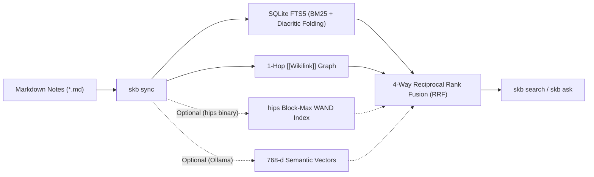

# Architecture: 4-Way Hybrid Retrieval & 6-Gate Vault Doctor

`sovereign-kb` (`skb`) turns any plain-text Markdown directory into a deterministic, local-first knowledge graph and hybrid search index backed by a single SQLite file (`.kb/index.db`) and optional sub-millisecond Rust Block-Max WAND acceleration (`hips`).



---

## 1. The 5-Stage Retrieval Pipeline (`skb search`)

When you run `skb search "<query>"`, Markdown files are split along code-fence-aware `H1 > H2 > H3` breadcrumbs and ranked across five stages:

1. **Stage 1A — Column-Weighted SQLite FTS5 BM25 + Compound Identifier Compiler**:
   - Preserves hyphenated and dotted technical identifiers (`ADR-0042`, `qwen3.6-35b-a3b`, `v1.4.0`) alongside Unicode NFD/NFC accent folding (`συνείδησις` $\leftrightarrow$ `συνειδησις`, `Café` $\leftrightarrow$ `cafe`).
   - Weights `bm25(chunks_fts)` across `(rel_path: 1.5, title: 4.0, doc_type: 1.5, tags: 2.5, heading_path: 3.0, content: 1.0, folded_content: 1.0)`.
2. **Stage 1B — Optional `hips` Rust Block-Max WAND Engine ([`jasonthird/high-performance-search-engine`](https://github.com/jasonthird/high-performance-search-engine))**:
   - When the `hips` binary by **Iason Malkotsis** (`@jasonthird`) is installed (`KB_HIPS_BIN`), `skb sync` automatically exports `.kb/hips-chunks.jsonl` and builds `.kb/hips-index/` (`hips index --code --title-weight 3 --reorder path`), adding sub-millisecond Frame-of-Reference (FOR) bit-packed Block-Max WAND retrieval (`--engine auto|hips|fts5`).
3. **Stage 2 — Optional 768-d Local Semantic Vector Similarity**:
   - Queries local Ollama (`nomic-embed-text:latest`) with automatic multi-endpoint failover (`KB_EMBED_URL`, `KB_EMBED_FALLBACK_URLS`) and SHA-256 content-addressed vector caching across schema migrations.
   - If no embedding server is running (or `--no-embed` / `KB_NO_EMBED=1` is set), `skb` automatically operates in fast zero-network lexical + graph mode.
4. **Stage 3 — 4-Way Reciprocal Rank Fusion (RRF) + Full Query-Term Coverage Bonus**:
   $$S_{\text{RRF}}(c) = \frac{w_{\text{FTS}}}{k + r_{\text{FTS}}(c)} + \frac{w_{\text{HIPS}}}{k + r_{\text{HIPS}}(c)} + \frac{w_{\text{vec}}}{k + r_{\text{vec}}(c)} + \beta_{\text{id}} \cdot N_{\text{exact}}(c) + \beta_{\text{cov}} \cdot \text{cov}(c, Q), \quad k = 30$$
   where $\text{cov}(c, Q) \in [0, 1]$ measures the fraction of query terms matched inside chunk $c$, ensuring passages that answer all parts of a multi-word query rank above partial matches.
5. **Stage 4 — 1-Hop `[[Wikilink]]` Graph Propagation with Parent Ceiling & MOC Hub Suppression**:
   - Extracts `[[wikilink]]` edges outside fenced/inline code blocks, suppresses high-degree Map-of-Content hubs (`type: moc` such as `INDEX.md`) from polluting 1-hop expansion, and boosts chunks in 1-hop neighbor documents by $1.15\times$ while capping neighbor scores below their propagating parent ($\le 0.98 \cdot S_{\text{parent}}$) so a 1-hop neighbor never overtakes the `#1` direct match.

### Search & HIPS CLI Reference

```bash
# Default clean human output
skb search "SQLite offline decision"

# Show full RRF, HIPS WAND, vector cosine, and BM25 rank telemetry
skb search "SQLite offline decision" --explain

# Machine-readable JSON output for AI coding agents
skb search "SQLite offline decision" --json

# Filter by frontmatter type or tag, or select engine explicitly
skb search "font embedding" --type operating-system --engine fts5

# Direct interface to the hips Block-Max WAND engine
skb hips status
skb hips index
skb hips search "Block-Max WAND" --json
skb hips bench "Block-Max WAND"
```

---

## 2. The 6-Gate Deterministic Vault Doctor (`skb verify`)

`skb verify` (aliased as `skb doctor` and `skb lint`) enforces six deterministic invariants across your vault and environment:

```text
=== Sovereign-KB Deterministic Verification (6-Gate Doctor): PASS ===
  Gate 1 (Frontmatter Schema) : PASS
  Gate 2 (Wikilink Integrity) : PASS
  Gate 3 (Graph Connectivity) : PASS
  Gate 4 (FTS5, HIPS & Vecs)  : PASS (164/164 vectors, HIPS WAND: OK)
  Gate 5 (Git & Media Hygiene): PASS
  Gate 6 (Skills & Plugins)   : PASS (146 skills verified)
```

| Gate | Invariant Verified |
| :--- | :--- |
| **Gate 1 — Frontmatter Schema** | Every note (except `AGENTS.md`) defines `title`, `type`, `updated`, and `tags` in YAML frontmatter. |
| **Gate 2 — Wikilink Integrity** | Every `[[wikilink]]` outside fenced/inline code resolves to an existing vault note (`0` broken links). |
| **Gate 3 — Graph Connectivity** | Every note (except root `INDEX.md` and `AGENTS.md`) has $\ge 1$ inbound `[[wikilink]]` (`0` orphan notes). |
| **Gate 4 — FTS5, HIPS & Embeddings** | SQLite `chunks_fts` passes `integrity-check`, document counts match disk, vector embeddings are complete (when embeddings are enabled), `.kb/hips-index` is verified when `hips` is installed, and `.kb/rsi-ledger.jsonl` SHA-256 chain integrity is verified. |
| **Gate 5 — Git & Media Hygiene** | Zero tracked `.mp4`, `.mov`, `.pyc`, or `.DS_Store` binaries in the Git index. |
| **Gate 6 — Agent Skills & Plugins** | Validates YAML frontmatter syntax and schema across installed agent `SKILL.md` files. |

### Auto-Healing Existing Markdown Folders (`skb verify --heal`)

If you point `skb` at an existing folder of plain `.md` files (such as an Obsidian vault or project `docs/` folder) that lack YAML frontmatter or `INDEX.md` links, Gate 1 and Gate 3 will report violations and print a one-line remediation hint:

```bash
# Automatically generate missing YAML frontmatter and wire orphan notes into INDEX.md
skb verify --heal

# Emit machine-readable JSON verification report
skb verify --json
```
